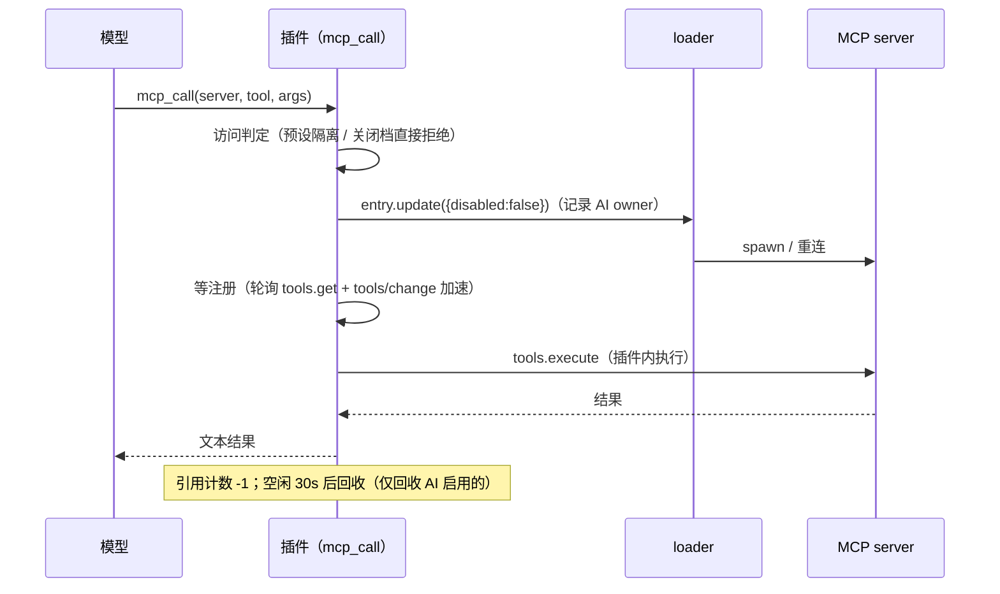

<p align="center">
  <strong style="font-size: 2.2em">🧩 MCP 管理面板</strong><br>
  <span style="font-size: 1.1em">DeepSeek Harness（DSH）Web 插件 · 每个 MCP 四档曝光 · 按 agent 预设做运行时隔离 · 按需调用不占上下文</span>
</p>

<p align="center">
  <a href="./README.en.md">🌐 English</a> · <strong>中文</strong>
</p>

<p align="center">
  
  
</p>

---

## ✨ 是什么

一个设置页面板，为每个 MCP 服务器选择**曝光档位**（进多少上下文）与**预设关联**（哪些会话能用）。

全注入会吃掉上下文，全关掉又用不上 —— 所以这里把「这个 MCP 对模型曝光多少」做成每服务器一个档位，把「哪些会话能用」做成预设关联；不被注入的 MCP 由 `mcp_search` / `mcp_call` 按需调用。


> 上图为 v0.5 的界面（启停开关 + 中间层开关）；v0.6 起改为每张卡片的四档选择器 + 预设关联折叠区。

## 🎚️ 四个档位

| 档位 | 进程 | 上下文注入 | `mcp_search` | `mcp_call` |
| --- | --- | --- | --- | --- |
| **原生注入** `native` | 运行 | 全部 `mcp__<server>__*` 工具 schema | 摘要表列出（标注已注入） | 可调用 |
| **仅名称** `name-only` | 运行 | 只有一行「服务器名 + 摘要」索引 | 摘要表列出 | 可调用（不传工具名即返回工具清单） |
| **隐藏** `hidden` | 停用（调用时保活启用 → 空闲回收） | 无 | 只有关键词命中才返回 | 可调用 |
| **关闭** `off` | 停用 | 无 | 完全不出现 | 拒绝 |

档位同时决定两件事：**进程是否运行**（原生注入/仅名称 = 运行，隐藏/关闭 = 停用）与**注入多少上下文**。这是用户唯一需要操作的状态控件。

## 🧩 预设关联（运行时隔离）

| 模式 | 含义 | 会话无预设时 |
| --- | --- | --- |
| 全部预设 `all`（默认） | 所有会话可用 | 可用 |
| 仅以下预设 `only` | 只有列出的预设可用 | 不可用 |
| 排除以下预设 `except` | 除列出的预设外可用 | 可用 |

被预设隔离的服务器**仍在后台运行**：其他预设的会话看不到它、`mcp_search` 不返回它、`mcp_call` 拒绝调用。三处判定共用同一个函数，不会出现「看得到调不动」或「调得动看不到」的错位。

> 这解决的正是「一个会话用某 MCP、另一个会话不用」的场景 —— 不必为不同会话反复开关进程，也不必重启。

## 🎯 核心能力

| 能力 | 说明 |
| --- | --- |
| 🤖 **AI 中间层常驻** | `mcp_search`（检索私有目录）+ `mcp_call`（保活启用 → 调用 → 空闲回收）；工具名未知时 `mcp_call` 直接返回该服务器工具清单 |
| 🛠️ **工具级禁用** | server 档位之上按工具精确控制；被禁工具不进检索、调用直接拒绝 |
| 📊 **停用态回填** | 停用/隐藏的服务器仍显示「目录中有多少工具、约多少 token」（私有 catalog last-good 快照） |
| 📁 **项目级 MCP** | 读取 `<工作空间>/.dsh/mcps/**/mcp.json`，**仅该项目工作空间的会话可见**；文件改动热更新 |
| ✏️ **编辑 / 删除** | 面板直接改命令、参数、环境变量、URL、超时；删除会同时移除配置行、卸载运行时行并清理策略。预设组合行只读（附替代做法） |
| 📥 **从其它 Agent 导入** | 扫描本机已知 MCP 配置（opencode / zcode / Claude Code / Cursor / Gemini CLI / 项目 `.mcp.json`）→ 勾选 → 导入为全局或项目，可顺带设定档位；只读源文件，一次性快照 |
| ➕ **快速迁移** | 粘贴其它 harness 的 `mcpServers` JSON（Claude Code 等）→ 预览 → 一键添加为全局（profile patch）或项目（`.dsh/mcps/mcp.json`） |
| ⏱️ **生效时机** | 「立即生效」（下轮即变，含缓存代价提示）或「下次会话生效」（当前会话零缓存失效） |
| 💾 **重启保持** | 策略持久化到 `~/.dsh/dsh-mcp-panel/state.json`；启停意图在启动早期物化进组合文件 |
| 🌐 **双语界面** | 全部文案 zh/en，跟随 DSH 界面语言；明暗主题适配 |
| 🪶 **零常驻上下文** | 除中间层两个工具外不注册任何模型工具；隐藏/关闭的 MCP 不占上下文 |

## 📦 安装

```sh
dsh plugin --profile web add "github:lilyblessing/dsh-mcp-panel#main"
```

产物已入库（`lib/`），git 源一行安装，无需构建授权。安装后**重启 `dsh web`**（bundle 层在启动时合成，热更新无效），设置页即出现「MCP 管理面板」入口。

> 📦 已发布到 **npm**：`dsh-mcp-panel`（[npm 页面](https://www.npmjs.com/package/dsh-mcp-panel)）。npm 版为预构建产物，安装可跳过 `allowBuilds` 构建授权。
>
> ⬆️ **升级**：git 源用户请在 DSH profile 目录执行 `pnpm update dsh-mcp-panel`（`pnpm add` 对相同 spec 不会重解析 git 分支）。

### 从 0.5.x（dsh-mcp-skill-panel）升级

1. **技能功能已整体移除**（技能请交给你的技能管理插件）；面板入口从「MCP 与技能管理面板」变为「MCP 管理面板」。
2. **包名与挂载 id 变更**，profile 需重装一次：

```sh
cd ~/.dsh/profiles/web
pnpm remove dsh-mcp-skill-panel
pnpm add "file:/path/to/dsh-mcp-panel"     # 或 github:lilyblessing/dsh-mcp-panel#main
# 并把 package.json 的 dsh.profile.bundles 中 dsh-mcp-skill-panel 改成 dsh-mcp-panel
```

3. **数据目录自动迁移**：`~/.dsh/dsh-mcp-panel/state.json` 不存在时，会从 `~/.dsh/dsh-mcp-skill-panel/` 搬运 `state.json` 与 `catalog.json`。
4. **策略结构 v1 → v2 自动迁移**（原 `autoManage` + 启停意图 + 工具级禁用 → 每服务器档位 + 预设关联 + 禁用工具），迁移前原文件备份为 `state.v1.json`：

   | 旧状态 | 新档位 |
   | --- | --- |
   | 已停用 + 旧 `autoManage: true` | **隐藏**（保持「AI 可按需调用」的行为） |
   | 已停用 + 旧 `autoManage: false` | **关闭** |
   | 已启用 | **原生注入** |

## 🚀 使用

1. 设置页 → **MCP 管理面板**
2. 每张卡片：服务器名、状态徽标、**四档选择器**、统计（工具数、token 估算、传输方式、工作区）
3. **档位选择器**：原生注入 / 仅名称 / 隐藏 / 关闭 —— 点击即改（立即生效模式会提示缓存代价）
4. **预设关联**（折叠区）：全部预设 / 仅以下预设 / 排除以下预设 + 预设多选；已删除的预设 id 标注「已不存在」，但不自动清理你的配置
5. **工具**（折叠区）：逐个禁用/启用该服务器的工具
6. **生效时机**：切换「立即生效 / 下次会话生效」；后者积压的意图可点「立即应用待生效变更」强制生效
7. **添加 MCP**：粘贴 `mcpServers` JSON，选择全局/项目目标后确认
8. **编辑 / 删除**：每张卡片右下角有「编辑」「删除」——编辑改的是配置源文件本身（全局行 → profile patch，项目行 → `.dsh/mcps/mcp.json`），删除会二次确认。若该行声明在 agent 预设组合里（`agent.cordis.yml`），卡片会标「只读」并禁用这两个按钮（原因见下方「配置写回矩阵」）
9. **从其它 Agent 导入**：右上角「从其它 Agent 导入」→ 自动扫描本机已知来源 → 勾选要搬进来的服务器（可追加自定义 JSON 路径）→ 选目标与导入后档位 → 确认

> 状态徽标：🟢 运行中（有工具）/ ⚪ 已停止（档位为隐藏或关闭）/ 🟡 无工具（进程在跑但工具列表为空）/ 🔴 未运行（期望运行但进程没起来，多为 server 启动失败）。

## 🔌 HTTP API

前缀 `/api/mcp-panel`（旧前缀 `/api/mcp-skill-panel` 与 `/api/runtime-inventory` 仍兼容）。

| 方法 | 路径 | 说明 |
| --- | --- | --- |
| GET | `/state?session=<id>` | 面板视图（注册表行 × 策略 × 预设隔离后的生效档位） |
| GET | `/presets?session=<id>` | 可关联的 agent 预设列表 |
| POST | `/policy` | `{ updates: [{ serverName, workspace?, exposure?, presets?, disabledTools? }] }` 批量写策略 |
| POST | `/policy/commit` | 立即应用「下次会话生效」模式积压的意图（有缓存代价） |
| POST | `/mcp/toolToggle` | `{ serverName, workspace?, toolName, disabled }` 工具级禁用 |
| GET | `/mcp/detail?serverName=&workspace=` | 编辑弹窗初值：可写目标、当前配置、动态（`!!js`）键清单 |
| POST | `/mcp/update` | `{ serverName, workspace?, patch: { serverName?, transport?, command?, args?, env?, cwd?, url?, headers?, toolCallTimeoutMs? } }` 编辑并写回源文件 |
| POST | `/mcp/remove` | `{ serverName, workspace? }` 删除（预设组合行返回 400 与替代做法） |
| POST | `/mcp/scan` | `{ paths?: string[] }` 扫描其它 agent 的 MCP 配置（只读，内置清单 + 自定义路径） |
| GET | `/config` | 读取生效时机与部署配置（middleLayer / defaultExposure） |
| POST | `/config` | `{ applyMode: immediate\|next-session }` |
| POST | `/mcp/preview` | `{ json }` 快速迁移预览（mcpServers JSON → 解析 + YAML patch 转换） |
| POST | `/mcp/add` | `{ json, target: global\|project, workspace? }` 添加 MCP |
| GET | `/debug` | 采集诊断 + scope 解析现场 + 注册表/策略快照 |
| POST | `/debug/collect` | 手动触发一次 catalog 采集 |
| GET | `/token` | 取本进程随机令牌（面板 POST 前自动获取并携带 `x-panel-token` 头） |

> **写操作鉴权**：全部 POST 要求 `x-panel-token` 与本进程随机令牌一致，否则 401 —— 阻断跨源 / DNS-rebinding 对本地控制端点的盲写；GET 只读端点保持开放。
> **分域缓存**（60s TTL 兜底）由事件驱动精确失效：`tools/change` / `loader/partial-dispose` → 面板域与注册表。

## ⚙️ 工作原理

```
┌ panel 面板层 ────────────────────────────────────────────────┐
│  collect.ts（视图）· routes.ts（端点）· client/*（单页面板）  │
└──────────────────────┬───────────────────────────────────────┘
┌ policy 策略层（唯一真源）─────────────────────────────────────┐
│  domain/policy.ts   意图（持久化）/ 生效（运行时）两份表        │
│  domain/exposure.ts 四档判定 · 预设隔离 · v1→v2 迁移（纯逻辑）  │
└──────────────────────┬───────────────────────────────────────┘
┌ runtime 运行时层 ────────────────────────────────────────────┐
│  domain/registry.ts  三种来源 → 统一 ServerRef（同步快照）      │
│  catalog.ts          工具目录快照 / 检索 / last-good 持久化     │
│  mcpcall.ts          启停保活 + 空闲回收 + mcp_search/mcp_call │
└──────────────────────┬───────────────────────────────────────┘
┌ assembly 装配层（唯一注入点）─────────────────────────────────┐
│  domain/assembly.ts  一个 system-prompt/assemble 监听器：       │
│                      按档位过滤工具 + 注入「仅名称」索引段       │
└──────────────────────────────────────────────────────────────┘
```

**三种 MCP 来源归一**：`ctx.loader.entries()`（profile patch 行 / 项目级 `projmcp-*` 行，同步）+ `ctx.agentPresets.compositionInventory()`（preset standing 行，rc.1 起不在 loader 里，异步刷新）+ 项目级 owner 表。装配发生在同步路径（waterfall 与 section provider 不能 await），因此注册表维护一份同步内存快照；快照未就绪时**保守放行**（保留工具），绝不误伤。

**一个决策函数**：装配过滤、`mcp_search`、`mcp_call`、面板徽标共用 `decideExposure({ policy, running, aiActive, presetId })`：

1. 预设不允许 → `off`（运行时隔离，物理状态不变）
2. `off` / `hidden` 档 → 原样
3. `native` / `name-only` 档：进程在跑且非 AI 保活窗口 → 原档；否则降级为 `hidden`（工具不注入，但仍可 `mcp_call`，不静默丢能力）

**中间层调用链**（`mcp_call` 对隐藏的 server）：



**配置写回矩阵**（编辑/删除的目标文件）：

| 行的来源 | 文件 | 编辑/删除 |
| --- | --- | --- |
| 全局行 | `~/.dsh/profiles/<profile>/cordis.patch.yml`（loader 里这些行的 `tree.filename` 是根树 backing `cordis.yml`，每次启动被重置为空，所以真正要写的是同目录的 patch 文件） | 文本级替换/删除该行块，随后同步 loader |
| 项目行 | `<workspace>/.dsh/mcps/**/mcp.json` | 改/删 JSON 键后重扫挂载 |
| 预设组合行 | `<preset>/agent.cordis.yml` | **只读**：运行期写它会触发 standing 重挂事故；面板标「只读」并引导用「关闭」档位 |

顺序固定为「先写文件、再动运行时」：反过来会出现「运行时改了但没落盘」的半状态。含 `!!js` 动态表达式的字段在编辑时以只读形式展示、写回时原样保留，绝不把表达式固化成当前值（否则导入进来的 `${VAR}` 会被写成明文密钥）。

**持久化为何分两步**：`dsh-agent-presets` 用 `{mtimeMs, size}` stamp 检测组合文件变化并重挂 standing，而旧实例不会 dispose → 运行期写组合文件会导致 `serverName` 全冲突、会话创建失败（实测事故）。因此策略只写插件自己的 `state.json`，由启动早期（standing 未挂载）的物化把期望 `disabled` 写进组合文件。物化三条规则：**首次采用**（按文件现状建档，绝不反向覆盖用户手工配置）、**尊重外部修改**（文件与账本不一致时只对齐账本）、**物化**（期望 ≠ 现状才写）。

## ✅ 验证清单

| 检查项 | 操作 | 预期 |
| --- | --- | --- |
| 面板入口 | 重启后打开设置页 | 出现「MCP 管理面板」，四档选择器可见，zh/en 跟随界面语言 |
| 原生注入 | 某 server 设为「原生注入」 | 工具出现在模型上下文；`mcp_search` 摘要标注「已直接注入」 |
| 仅名称 | 切到「仅名称」 | 上下文只剩一行「服务器名 + 摘要」；`mcp_call` 不传工具名返回该 server 工具清单 |
| 隐藏 | 切到「隐藏」 | 工具从上下文消失、进程停用；`mcp_search` 能检索到；`mcp_call` 能调用（空闲后回收） |
| 关闭 | 切到「关闭」 | `mcp_search` 不返回、`mcp_call` 拒绝并提示 |
| 预设隔离 | 某 server 关联「仅以下预设: coding」 | coding 会话正常；其他预设会话看不到工具、`mcp_call` 拒绝；进程仍在运行 |
| 工具级禁用 | 展开工具列表禁用某工具 | 该工具从上下文与 `mcp_search` 消失，`mcp_call` 拒绝 |
| 重启保持 | 改档位后重启 DSH | 档位与预设关联保持不变 |

## ⚠️ 已知限制

- **预设 standing 行的进程状态需要重启才能改变**：rc.1 起预设行不在 loader 中，插件无法即时启停它们（运行期写组合文件会触发 standing 重挂事故）。运行期对它们的「可见/可调用」由装配与中间层即时保证；进程启停随下次启动的物化生效。
- 会话中途改变档位/关联/工具禁用会使该会话的 Prompt Cache 失效（面板有提示）；介意费用请用「下次会话生效」。
- 「仅名称」档位会引入一段常驻索引文本（每个 server 一行）；隐藏/关闭则不引入。
- preset 关联里被删除的预设 id 不会自动清理（保留配置，面板标注「已不存在」）。
- 项目级 MCP 仅对**相同工作空间**的会话可见（按会话 cwd 判定，不做 `.git` 向上查找）。
- **预设组合行只读**：`agent.cordis.yml` 里的 MCP 行不能从面板编辑或删除（框架约束，写该文件会让整个预设重挂并导致 MCP 名字冲突）。要让它们失效请用「关闭」档位；要真删请直接改文件。
- **项目级 MCP 不支持改名**：它的名字由 `.dsh/mcps` 下的配置键决定，运行时的挂载名额外带路径哈希后缀；改名请直接编辑该文件。
- **导入不跟踪源文件后续变化**：一次性快照，且不会修改源文件。
- **不支持 TOML**：Codex 的 `~/.codex/config.toml` 与 Zed 的 `context_servers` 只在扫描结果里标注「已跳过」。

## 🛠️ 开发

```sh
pnpm install
pnpm setup          # 把 DSH 闭包 junction 进 node_modules（类型解析用）
pnpm typecheck      # tsc --noEmit
pnpm build          # tsdown → lib/*.js + tsc dts → lib/types
pnpm verify         # 产物校验（external 未内联 / 入口齐全 / client 包装）
node scripts/selftest-exposure.mjs   # 领域纯逻辑：四档判定 / 预设隔离 / 迁移 / 物化规则
node scripts/selftest-policy.mjs     # 策略层端到端：目录搬迁 / v1→v2 迁移 / 生效时机（临时 HOME）
node scripts/selftest-mcp.mjs        # catalog 检索 / 组合文件文本 / 项目扫描 / JSON 转换
```

代码分层：`src/domain/`（纯逻辑与策略）→ `src/*.ts`（运行时与面板）→ `src/client/`（浏览器视图）。
`lib/exposure.js` 是领域纯逻辑的独立构建入口，供自测直接断言真值表。

## 📋 变更日志

### v0.6.1 — 编辑 / 删除 / 从其它 Agent 导入

- **编辑**：面板直接改 serverName、传输方式、命令、参数、环境变量、工作目录、URL、请求头、工具调用超时；写回配置源文件并同步运行时。改名会自动迁移档位、预设关联与工具级禁用（含 `mcp__old__` → `mcp__new__` 前缀重写）
- **删除**：二次确认后移除配置行 + 卸载 loader 行 + 清理策略
- **从其它 Agent 导入**：扫描 opencode / zcode / Claude Code / Cursor / Gemini CLI / 项目 `.mcp.json` 等已知来源（可追加自定义路径），格式自动嗅探（`mcpServers` / `mcp` / `mcp.servers` / `servers` / 裸映射），字段自动归一（`type: local|remote`、`command` 数组、`environment` → `env`），导入时可顺便设定档位
- **只读保护**：声明在 agent 预设组合里的行标注「只读」并禁用编辑/删除（附原因与替代做法）
- **动态表达式保护**：含 `!!js` 的字段编辑时只读、写回时原样保留，避免把 `${VAR}` 固化成明文
- **修复（v0.6.0 遗留）**：
  1. 全局行（profile patch 行）的「停用」状态从未写回文件 —— loader 里这些行归属根树 `cordis.yml`，物化时必须落到同目录的 `cordis.patch.yml`，否则重启后「隐藏/关闭」档位的进程又跑起来
  2. 「文件中无 disabled 键」被误判成「行不存在」，导致标志永远写不进去（`null` 歧义）
  3. 组合文件的文本操作只认行首 `- id:`，对 patch 文件的缩进行无效

### v0.6.0 — 四档曝光 + 预设运行时隔离（破坏性重构）

- **移除技能功能**（技能交给独立的技能管理插件）；插件定位收敛为「MCP 可见性与可用性的单一控制面」
- **四档曝光**取代原「启用/停用 + 全局 autoManage 开关」：原生注入 / 仅名称 / 隐藏 / 关闭
- **预设关联**（运行时隔离）：`all` / `only` / `except` + 预设多选；装配、`mcp_search`、`mcp_call` 三处一致生效，进程保持后台运行
- **`mcp_call` 支持只传 server**：工具名未知/为空时返回该服务器的工具清单（「仅名称」档位的发现路径）
- **`mcp_search` 摘要按档位分层**：列出原生注入与仅名称的服务器，隐藏的只给计数提示，关闭与预设隔离的完全不出现
- **架构重排**：三个各自过滤 `system-prompt/assemble` 的模块合并为单一装配层；live 行与 preset 行的两套构建路径归一为注册表；意图/生效两份表取代 desired/lastApplied/pending 多轨状态
- **改名**：包名与挂载 id → `dsh-mcp-panel`（入口「MCP 管理面板」，HTTP 前缀 `/api/mcp-panel`，旧前缀兼容）
- **自动迁移**：数据目录（`dsh-mcp-skill-panel` → `dsh-mcp-panel`）与 state.json v1 → v2，迁移前备份 `state.v1.json`

### v0.5.x 及更早

历史版本（rc.1 兼容、Prompt Cache 优化、工具级禁用、项目级 MCP、快速迁移等）见 git 历史与 `decisions/implemented/`。

## 📄 License

MIT
